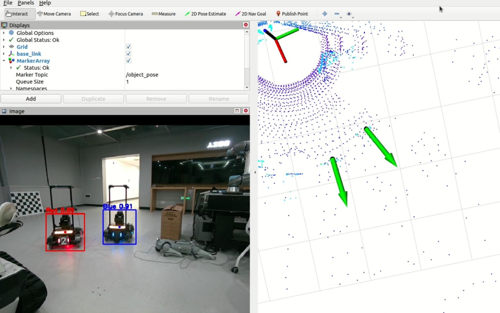

## 📜 Introduction

Object detection and orientation prediction for RoboMaster robots.(Click the image to view the video)

[](https://www.bilibili.com/video/BV1H6qgB4EKB/?share_source=copy_web&vd_source=3ff6add1b4cf98ece29e1f85a9e54273)


## 🛠️ Installation

### Test Environment
* JETSON AGX ORIN
* Ubuntu 20.04
* ROS Noetic

### 🚀 Quick Start

#### Clone our repository and build
```bash
git clone https://github.com/Bling-sun/RLTP.git
cd RLTP
catkin_make --only-pkg-with-deps obj_state_msgs
catkin_make -DCATKIN_WHITELIST_PACKAGES=""
```
#### Configure tmux
*This procedure is optional*: You can choose to launch all the ros nodes in `RLTP_start.yaml` one by one.

```bash
# install tmux
sudo apt install tmux
sudo apt install tmuxp
```

#### Launch the system
```bash
tmuxp load RLTP_start.yaml
tmux kill-session -t RLTP 
```

## 🤓 Acknowledgments

Sincere thanks to the following projects for their invaluable support and inspiration:
- [FAPP](https://github.com/arclab-hku/FAPP): Fast and Adaptive Perception and Planning for UAVs in Dynamic Cluttered Environments.